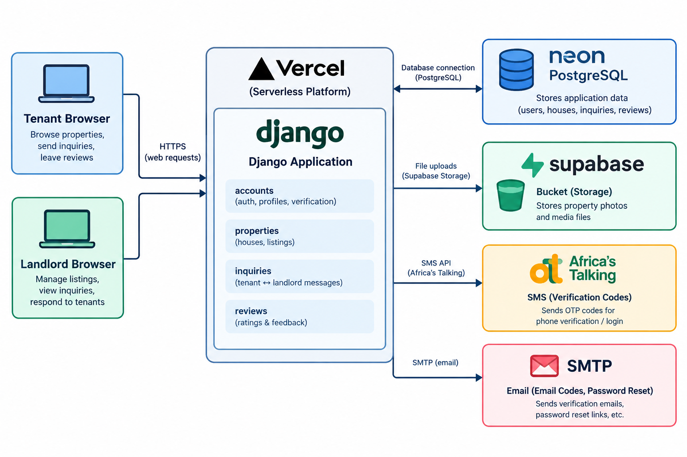

# Saka Keja Use Cases

Two worked scenarios, followed by formal use case tables. Everything here matches the current code.

## 1. Actors

| Actor | Description |
|---|---|
| Tenant | Registered user (role = tenant) looking for a house |
| Landlord | Registered user (role = landlord) listing houses |
| Admin | Staff user managing locations, users, houses and reviews at `/admin/` |
| Visitor | Not logged in; can browse and search, nothing else |
| SMS provider | Africa's Talking, sends phone codes |
| Email server | SMTP, sends email codes and password resets |

## 2. Scenario A: Tenant (Wanjiru finds a house)

**Goal:** find a 2-bedroom house in Mukuyu Market under KSh 12,000 and contact the landlord.

| Step | What Wanjiru does | What happens inside the system |
|---|---|---|
| 1 | Registers as a **Tenant** | `accounts` stores her sign-up in `PendingRegistration` (password already hashed, tied to her browser session). No `User` exists yet. |
| 2 | Submits the form (Kenyan phone number required, format-checked) | No SMS is sent: tenants verify their email only. A 6-digit email code (10 min) is sent. |
| 3 | Enters the email code | The code is checked. Only now is the `User` created. Her phone is stored in international format, unverified. |
| 4 | Searches location = Mukuyu Market, 2 bedrooms, max rent 12,000 | `properties` filters houses by location, type, rent range, exact bedrooms and minimum bathrooms. 12 results per page. |
| 5 | Opens a house | Photos load from Supabase Storage. Call and WhatsApp buttons show. |
| 6 | Presses **Contact the landlord**, sends a message | `inquiries` saves an `Inquiry` linking her, the landlord and the house. |
| 7 | Reviews the landlord | `reviews` checks that an inquiry exists and no review exists yet. The review is public. |

## 3. Scenario B: Landlord (Mr. Kamau lists and responds)

**Goal:** list a house, answer an inquiry, review the tenant.

| Step | What Mr. Kamau does | What happens inside the system |
|---|---|---|
| 1 | Registers as a **Landlord**, completes both verifications | Landlords alone also verify the phone: a 6-digit SMS code (5 min; 60 s between sends, 5 attempts) first, then the email code. `is_landlord` is true, so **Add house** appears. |
| 2 | Adds a house | `properties` saves a `House` owned by him, using a location from the admin-managed list. |
| 3 | Uploads photos | Files go to the Supabase bucket. Files over about 4.5 MB fail on Vercel. |
| 4 | Opens **Inbox**, replies to Wanjiru | `inquiries` lists inquiries addressed to him. |
| 5 | Reviews Wanjiru | Allowed because an inquiry exists. The review is private (him and admins only). |
| 6 | An admin receives a report on a review | The report does not hide it. An admin unticks **Is visible** if it breaks the rules. |

## 4. How the pieces connect

```
Tenant browser ─┐                                   ┌─ Neon Postgres (users, houses, inquiries, reviews)
                ├─► Vercel (Django: accounts,       ├─ Supabase bucket (photos)
Landlord browser┘    properties, inquiries,    ────►├─ Africa's Talking (SMS codes)
                     reviews)                       └─ SMTP (email codes, password reset)
```

The shared record is the **Inquiry**. It links tenant, landlord and house, and it unlocks reviews, so only people who actually dealt with each other can rate one another.

## 5. Formal use cases

### UC-01 Register an account

| Field | Detail |
|---|---|
| Actors | Visitor, email server; SMS provider (landlords only) |
| Precondition | Visitor has an email address. Landlords also need a phone that receives SMS. |
| Main flow (tenant) | 1. Fill the form and choose Tenant (phone required, format-checked, no SMS). 2. Submit; email code is sent. 3. Enter it (10 min lifetime). 4. Account is created. |
| Main flow (landlord) | 1. Fill the form and choose Landlord (phone required). 2. Request the phone code. 3. Enter it (5 min lifetime). 4. Submit; email code is sent. 5. Enter it (10 min lifetime). 6. Account is created. |
| Alternate flows | **Wrong code:** error shown; 5 attempts per code. **Expired code:** request a new one. **Resend too soon:** wait 60 s. **Too many sends:** 5 per phone per hour, 10 per IP per hour. **Other browser or over 30 minutes:** pending sign-up lost; register again. |
| Postcondition | `User` exists only after verification: email for tenants, phone and email for landlords. A tenant's phone is format-checked and stored unverified. |

### UC-02 Log in and reset password

| Field | Detail |
|---|---|
| Actors | Tenant, Landlord, Admin, email server |
| Main flow | Enter username (not email) and password. |
| Alternate flow | Forgot password: request a reset email, open the link, set a new password. |
| Postcondition | Session started, or password changed |

### UC-03 Search and view houses

| Field | Detail |
|---|---|
| Actors | Visitor, Tenant |
| Main flow | 1. Open the home page or house list. 2. Apply filters: location, type, price range, bedrooms (exact), bathrooms (at least). 3. Browse results (12 per page). 4. Open a house for photos, rent and contact buttons. |
| Alternate flow | No results: filters can be relaxed. |

### UC-04 Contact a landlord

| Field | Detail |
|---|---|
| Actors | Tenant, Landlord |
| Precondition | Tenant is logged in; the house exists |
| Main flow | 1. Open a house. 2. Press **Contact the landlord**. 3. Send the message. 4. The landlord sees it in **Inbox**; the tenant tracks it in **My inquiries**. |
| Alternate flow | Not logged in: redirected to login first. |
| Postcondition | An `Inquiry` links the tenant, landlord and house |

### UC-05 List a house

| Field | Detail |
|---|---|
| Actors | Landlord |
| Main flow | 1. Press **Add house**. 2. Fill type, rent, bedrooms, bathrooms, location, description. 3. Save. 4. Upload photos. |
| Alternate flows | Photo over about 4.5 MB: upload fails. Edit or remove from **My houses**. |

### UC-06 Leave a review

| Field | Detail |
|---|---|
| Actors | Tenant (reviews landlord), Landlord (reviews tenant) |
| Precondition | An inquiry exists between the two |
| Main flow | Choose a star rating, write a comment, submit. |
| Rules | One review per pair. Review of a landlord is public. Review of a tenant is private. |
| Alternate flow | No inquiry, or already reviewed: submission refused. |

### UC-07 Report and moderate a review

| Field | Detail |
|---|---|
| Actors | Any reviewed user, Admin |
| Main flow | 1. A user reports a review. 2. The admin opens it in `/admin/`. 3. If it breaks the rules, the admin unticks **Is visible**. |
| Rule | A report never hides a review automatically. |

### UC-08 Administer the platform

| Field | Detail |
|---|---|
| Actors | Admin |
| Main flow | Add locations; change roles or deactivate users; edit or remove houses; moderate reviews. |
| Note | Deactivate users instead of deleting those with linked records, which can raise an integrity error. |


